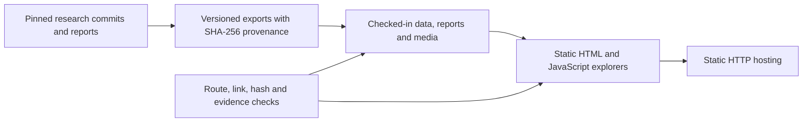

# Mindscape website

**A static research publication and evidence explorer for the Mindscape project.**

The site presents research reports, architecture, versioned measurements and recorded application showcases across 13 canonical HTML routes. It ships complete HTML/CSS/JavaScript, media and evidence exports under `dist/`; a static server can publish it without installing packages or running a build. Interactive charts select preserved measurements rather than executing models.

[Research source](https://github.com/akilanpl/mindscape) · [Evidence exports](dist/assets/) · [Static integrity tests](tests/verify_site.py)

## Publication architecture



The searchable research index contains 71 records, including 45 preserved historical PDFs. Version filters distinguish historical work, R5/R6 research and the hybrid assistant. Reports retain source identities, frozen denominators and experiment outcomes. Feature-branch explanation work is identified separately from the `mindscape` main snapshot.

Advancements exposes learning-budget, horizon, coding, latency and model-error explorers backed by frozen JSON. Sliders choose recorded cells; exact values and source links remain visible. Architecture pages explain the reasoning lifecycle with preserved traces. `/mind/` presents Epitome with a procedural galaxy, benchmark tabs and recorded workspace showcases; the former R5.4 announcement and its evidence remain under `/mind/archive/r54/`.

## Evidence and maintenance

| Path | Responsibility |
|---|---|
| [dist/](dist/) | Deployable pages, shared styles/scripts, fonts and media |
| [dist/research-data.js](dist/research-data.js) | Searchable report catalog and version labels |
| [dist/assets/v3/](dist/assets/v3/) | Preserved reports, integration traces, chart data and hashes |
| [dist/assets/october-2026/](dist/assets/october-2026/) | Hybrid/native research exports with provenance |
| [dist/mind/](dist/mind/) | Current announcement, recorded showcases and historical archive |
| [scripts/export_mind_evidence.py](scripts/export_mind_evidence.py) | Explicit export from pinned research source |
| [tests/](tests/) | Static integrity, evidence consistency and interaction-contract checks |

`export_mind_evidence.py` requires an explicit `--research` checkout and reads commit `950a17519f43fbc887e41f29ce2e24d4b6036ead`. It exports source-bound historical evidence; it is not a general updater for the current announcement. `scripts/update_v3.py` records an earlier one-time migration. Do not rerun either merely to preview the site. Subsequent editorial changes can be made directly to static files while preserving source URLs, hashes and scientific qualifications.

Website checks verify publication consistency, not research reproducibility by themselves. They do not rerun training, inference or benchmarks, and an illustrative animation does not establish model computation. Research execution and scientific conclusions belong to the linked source repository and its experiment receipts.

## Preview and verify

Python 3 and Node.js are sufficient for the checks below; no npm installation or build step is required.

```sh
python3 -m http.server 4173 --bind 127.0.0.1 --directory dist
```

Open `http://127.0.0.1:4173/`. In another terminal:

```sh
python3 tests/verify_site.py
python3 tests/test_mind.py
node --check dist/research.js
node --check dist/mind/mind.js
git diff --check
```

The two Python suites define 17 site checks and 10 announcement checks: routes/local targets, unique IDs, historical preservation, source hashes, report index, chart values, trace parity, static fallbacks and contact-form boundaries. Historical browser QA covered desktop pages, graph controls, keyboard tabs, research filters and mobile overflow. These recorded checks do not certify a new browser run or contact delivery. For visual changes, inspect reduced motion, keyboard navigation, chart controls and narrow viewports in a real browser as well.

## Static hosting and contact

The checked-in [Vercel configuration](vercel.json) selects `dist`, clean URLs and trailing-slash routes. Import as framework **Other**, repository root, output **dist**, with no build command. Git integration handles deployments when connected; a README update does not prove a successful deployment. Use the established repository author identity because the linked Vercel account checks commit-author association.

The two-step contact form posts to FormSubmit for `akilanpalaniyappan105@gmail.com`. Forwarding depends on mailbox-owner activation; FormSubmit owns its confirmation and spam checks. Static tests inspect the action and fields without submitting messages.

## Media provenance

The current homepage research film is an AI-generated illustration from Google Flow/Veo 3.1 Lite, with retained watermark, muted audio and a loop edit. [Film provenance](review/film/provenance.json) records original/export hashes and processing; it is not footage of a real experiment. [Epitome media provenance](dist/mind/media/provenance.json) identifies the unmodified application screenshots and their 16-second edited slideshow, which is not a live inference recording. The procedural galaxy is abstract artwork.

Preserved earlier writing footage is Pexels video **33350918 by Kelly (@kelly)**, downloaded 2026-10-11: [source](https://www.pexels.com/video/person-writing-in-notebook-at-desk-33350918/) · [Pexels license](https://www.pexels.com/license/). Its use illustrates the research vision without implying endorsement or showing a Mindscape team member.

Documentation basis: [`925a2b9`](https://github.com/akilanpl/mindscape-website/tree/925a2b9ffae2a30e29adeb9efab0a812dfe80a9c).
